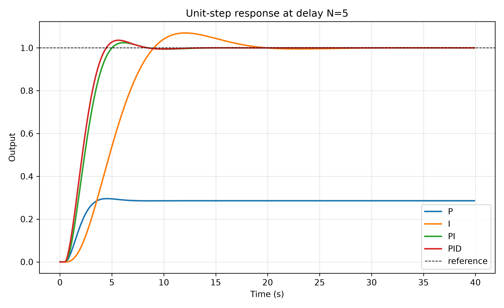
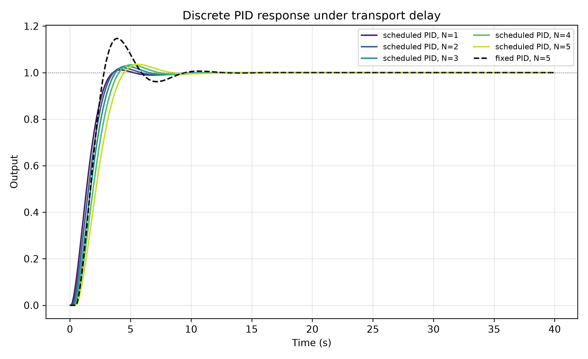
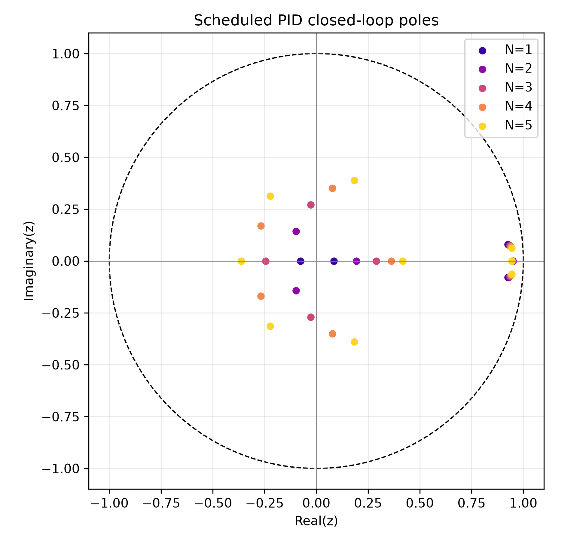

# Discrete-Time Control of a Plant with Integer Transport Delay

## 1. Problem Statement and Plant Model

The objective is to design and verify discrete P, I, PI, and PID controllers for a stable second-order plant subject to an integer transport delay. The continuous-time plant is the normalized first-order thermal model cascaded twice,

$$
G_c(s)=\frac{1}{(s+1)^2}, \qquad T_s=0.1\ \mathrm{s}.
$$

Zero-order-hold discretization gives

$$
G(z)=\frac{0.00467884z^{-1}+0.00437708z^{-2}}
{1-1.80967484z^{-1}+0.81873075z^{-2}},
\qquad G_N(z)=G(z)z^{-N}.
$$

The one- and two-sample numerator terms are the sampled plant dynamics; the separately modeled transport delay is $z^{-N}$, with $N\in\{0,1,2,3,4,5\}$. Stability and simulations below focus on $N=1,\ldots,5$. The feedback is unity and negative, the reference is a unit step, and the plant/controller start from rest. The delay is assumed constant during each run and known exactly, or estimated correctly as an integer, by the gain scheduler; if the estimate changes, the corresponding table row is selected. External disturbances are zero, feedback is noise-free, and actuator saturation is not modeled.

## 2. Discrete Controller Synthesis

The controller is represented in incremental form:

$$
u(k)=u(k-1)+q_0e(k)+q_1e(k-1)+q_2e(k-2).
$$

Its transfer function is $G_R(z)=(q_0+q_1z^{-1}+q_2z^{-2})/(1-z^{-1})$. With $T_s=0.1\ \mathrm{s}$, the selected coefficient mappings are:

| Structure | Gains | $(q_0,q_1,q_2)$ |
|---|---|---|
| P | $K_p$ | $(K_p,-K_p,0)$; algebraically reduced to the direct proportional law |
| I | $K_i$ | $(K_iT_s,0,0)$ |
| PI | $K_p,K_i$ | $(K_p+K_iT_s/2,\,-K_p+K_iT_s/2,\,0)$ |
| PID | $K_p,K_i,K_d$ | $(K_p+K_iT_s/2+K_d/T_s,\,-K_p+K_iT_s/2-2K_d/T_s,\,K_d/T_s)$ |

These are respectively direct proportional action, rectangular-sum integration, trapezoidal PI integration, and trapezoidal PI plus backward-difference derivative action. The simulation applies the P law directly as $u(k)=K_pe(k)$; its listed $(q_0,q_1,q_2)$ only express the equivalent incremental relation when the previous command and error states are consistent. The characteristic polynomial is reduced to the direct $K_p$ form, avoiding a canceled pole at $z=1$ and a redundant integrator state.

The delay-regime gain schedule is a lookup table, selected using the known/estimated integer delay. The delay estimate is assumed available before tuning the loop; there is no interpolation or online gain adaptation between rows. Gains are tapered with increasing delay to reduce loop aggressiveness; entries are $(K_p,K_i,K_d)$, with unused gains set to zero.

| $N$ | P | I | PI | PID |
|---:|---:|---:|---:|---:|
| 1 | (0.80, 0, 0) | (0, 0.50, 0) | (0.80, 0.50, 0) | (1.10, 0.65, 0.12) |
| 2 | (0.70, 0, 0) | (0, 0.42, 0) | (0.75, 0.48, 0) | (1.00, 0.60, 0.11) |
| 3 | (0.60, 0, 0) | (0, 0.35, 0) | (0.70, 0.46, 0) | (0.90, 0.55, 0.10) |
| 4 | (0.50, 0, 0) | (0, 0.28, 0) | (0.65, 0.43, 0) | (0.80, 0.50, 0.09) |
| 5 | (0.40, 0, 0) | (0, 0.22, 0) | (0.60, 0.40, 0) | (0.70, 0.45, 0.08) |

## 3. Theoretical Stability Proof

For negative unity feedback, each characteristic polynomial is obtained from

$$
1+G_R(z)G(z)z^{-N}=0.
$$

For I, PI, and PID, write $Q(z^{-1})=q_0+q_1z^{-1}+q_2z^{-2}$. The closed-loop polynomial in $z^{-1}$ is

$$
\Delta_N(z^{-1})=
A(z^{-1})(1-z^{-1})+B(z^{-1})Q(z^{-1})z^{-N},
$$

where $A=1-1.80967484z^{-1}+0.81873075z^{-2}$ and $B=0.00467884z^{-1}+0.00437708z^{-2}$. For P, the reduced polynomial is $A+B K_pz^{-N}$. The zeros of the resulting polynomial in $z$ are the closed-loop poles.

For a real polynomial $p(z)=a_0z^m+a_1z^{m-1}+\cdots+a_m$, the Schur-Cohn recursion requires $|a_m|<|a_0|$ and that the reduced polynomial

$$
p_1(z)=\frac{a_0p(z)-a_mp^\#(z)}{z}, \qquad
p^\#(z)=z^mp(1/z),
$$

also be Schur stable. Repeating the test down to degree zero is necessary and sufficient for all roots to lie strictly inside the unit circle; this is the recursive form of the Jury/Schur stability test. The computations evaluate the equivalent roots directly and require $\max_i|z_i|<1$.

The implementation applies this recursion numerically to every scheduled polynomial. At each reduced degree it records the reflection ratio $r_m=a_m/a_0$, then forms the next polynomial using the expression above; stability requires $|r_m|<1$ at every step. For each controller and delay, the largest absolute reflection ratio is:

| Delay $N$ | P | I | PI | PID |
|---:|---:|---:|---:|---:|
| 1 | 0.991118 | 0.998750 | 0.998672 | 0.998338 |
| 2 | 0.991697 | 0.998953 | 0.998687 | 0.998397 |
| 3 | 0.992267 | 0.999131 | 0.998713 | 0.998484 |
| 4 | 0.992811 | 0.999307 | 0.998778 | 0.998595 |
| 5 | 0.993320 | 0.999457 | 0.998853 | 0.998726 |

As an explicit $N=5$ recursion trace, the reflection ratios in descending degree order are:

| Controller | $r_m$ values, recursion from highest degree to degree 1 |
|---|---|
| P | $0.001751,\ 0.005040,\ 0.007688,\ 0.009786,\ 0.011418,\ 0.831641,\ -0.993320$ |
| I | $0.000096,\ 0.000373,\ 0.000796,\ 0.001334,\ -0.816771,\ 0.996092,\ -0.999457$ |
| PI | $-0.002539,\ -0.007133,\ -0.010468,\ -0.012744,\ -0.014133,\ -0.833949,\ 0.994659,\ -0.998853$ |
| PID | $0.003502,\ 0.003613,\ -0.003045,\ -0.008061,\ -0.011688,\ -0.014147,\ -0.834742,\ 0.994315,\ -0.998726$ |

All reported ratios have magnitude strictly below one, consistent with the pole-radius results. The polynomial arrays are stored as coefficients in ascending powers of $z^{-1}$; clearing denominators makes this ordering the descending-power coefficient sequence in $z$ expected by `numpy.roots`, so no reversal is applied before finding roots.

### Scheduled closed-loop pole radii

| Delay $N$ | P | I | PI | PID |
|---:|---:|---:|---:|---:|
| 1 | 0.911112 | 0.980304 | 0.953911 | 0.949242 |
| 2 | 0.914724 | 0.979781 | 0.952209 | 0.948484 |
| 3 | 0.917583 | 0.979009 | 0.950134 | 0.947520 |
| 4 | 0.919478 | 0.977654 | 0.949977 | 0.946227 |
| 5 | 0.920234 | 0.976081 | 0.949847 | 0.946007 |

The companion summary `results.json` contains each pole, maximum pole radius, and radial stability margin $1-\max_i|z_i|$. The scheduled designs are required by the script to have positive radial margin for every $N=1,\ldots,5$; execution aborts rather than emitting a stability claim if this check fails.

### Augmented-state Lyapunov certificate at $N=5$

The delay line is included explicitly in the state. Let

$$
\xi(k)=\begin{bmatrix}x(k)^T & u(k-1)&\cdots&u(k-5)&e(k-1)&e(k-2)\end{bmatrix}^T.
$$

With the PID recursion and zero reference, the state update is $\xi(k+1)=A_{\mathrm{aug}}\xi(k)$. A quadratic Lyapunov function $V(\xi)=\xi^TP\xi$ proves asymptotic stability if

$$
P=P^T\succ0,\qquad A_{\mathrm{aug}}^TPA_{\mathrm{aug}}-P\prec0.
$$

This augmented-delay Lyapunov formulation captures the finite memory of the transport delay (often described as a Lyapunov-Krasovskii construction). CVXPY/CLARABEL solves the LMI for the scheduled PID at each delay; the finite-dimensional delay realization changes dimension with $N$. All five solves returned **optimal**, and for each, $\lambda_{\min}(P)>0$ and $\lambda_{\max}(A_{\mathrm{aug}}^TPA_{\mathrm{aug}}-P)<0$:

| $N$ | Matrix dimension | Solver status | $\lambda_{\min}(P)$ | $\lambda_{\max}(A_{\mathrm{aug}}^TPA_{\mathrm{aug}}-P)$ | Maximum augmented pole magnitude |
|---:|---:|---|---:|---:|---:|
| 1 | 5 | optimal | $3.6312\times10^{-3}$ | $-3.6309\times10^{-3}$ | 0.949242 |
| 2 | 6 | optimal | $2.6047\times10^{-3}$ | $-2.6042\times10^{-3}$ | 0.948483 |
| 3 | 7 | optimal | $2.0832\times10^{-3}$ | $-2.0828\times10^{-3}$ | 0.947520 |
| 4 | 8 | optimal | $1.7842\times10^{-3}$ | $-1.7838\times10^{-3}$ | 0.946227 |
| 5 | 9 | optimal | $1.6041\times10^{-3}$ | $-1.6038\times10^{-3}$ | 0.946007 |

For every delay, the script also asserts that the eigenvalues of $A_{\mathrm{aug}}$ match the roots of the independently formed characteristic polynomial. The detailed solver results, numerical signs, and eigenvalues are included in `results.json`.

## 4. Simulation Results

Responses are simulated over $40$ seconds. Overshoot is relative to the unit reference; settling time is the first sample after which the response stays within a $\pm2\%$ band for the remainder of the run. The steady-state error is the absolute final tracking error. The fixed-gain comparison holds the $N=1$ PID gains $(1.10,0.65,0.12)$ at $N=5$, while the scheduled comparison uses the $N=5$ gains $(0.70,0.45,0.08)$.

### Performance at $N=5$

| Controller | Settling time (s) | Overshoot (%) | Steady-state error | Maximum pole radius $|\lambda|_{\max}$ |
|---|---:|---:|---:|---:|
| P | Not reached within 40 s | 0.00 | 0.714286 | 0.920234 |
| I | 17.1 | 6.96 | 0.000051 | 0.976081 |
| PI | 6.8 | 2.43 | $<10^{-6}$ | 0.949847 |
| PID | 7.0 | 3.56 | $<10^{-6}$ | 0.946007 |
| PID, fixed $N=1$ gains | 8.5 | 14.71 | $<10^{-6}$ | 0.953851 |

The fixed-gain row uses the same $N=5$ plant and delay as the scheduled PID row, changing only the PID gains. The machine-readable summary includes these fixed-gain metrics, response metrics for every scheduled controller across $N=1,\ldots,5$, Schur-Cohn recursion quantities, augmented-realization checks, and Lyapunov results.

## 5. Conclusion

For this sampled second-order plant and the stated gain table, the design objective is strict Schur stability across integer delays $N=1,\ldots,5$. The discrete poles and an independent $N=5$ Lyapunov certificate provide complementary checks of asymptotic stability. Integral action removes the proportional controller's steady-state offset; derivative action shapes transient damping, while the lookup schedule reduces gains as transport delay grows. The step and pole plots, together with the generated numerical metrics, show the measured trade-offs for this particular model and tuning rather than claiming delay-independent performance for arbitrary plants.
